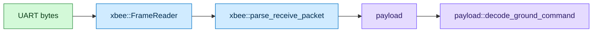

<div align="center">

# CanSat XBee Comms

### A heap-free C++17 library for CanSat ↔ ground station radio messaging over XBee


*Harre Prakash Kumar · TMU CanSat 2026–27 Flight Software Onboarding*

</div>

---

## Overview

A small C++17 library that converts between CanSat application messages and **XBee API frames**. It:

- builds **0x10 Transmit Request** frames around a payload,
- parses **0x90 Receive Packet** frames and extracts the payload,
- serializes `OutTelemetry` and deserializes `CommandMechanism` / `CommandTelemetry`,
- assembles frames from a raw UART byte stream (`FrameReader`), re-synchronising after errors.

> **Built for a small Arm Cortex-M:** no heap allocation, no exceptions, fixed-size buffers, no hardware dependencies. Everything is testable on a PC with byte arrays.

---

## How It Works

**Transmit**


**Receive**



> **Clean separation:** the XBee layer never looks inside the payload, and the payload layer knows nothing about addresses, frame IDs or checksums.

---

## Build and Test

**Requirements:** a C++17 compiler (GCC, Clang or MSVC), CMake ≥ 3.16, and internet access on the first configure (Google Test v1.15.2 is fetched automatically).

```bash
cmake -S . -B build
cmake --build build
ctest --test-dir build --output-on-failure      # or: ./build/cansat_comms_tests
```

To use only the library from another CMake project:

```cmake
set(CANSAT_COMMS_BUILD_TESTS OFF)
add_subdirectory(cansat-xbee-comms)
target_link_libraries(flight_software PRIVATE cansat::comms)
```

---

## Project Layout

| Path | Contents |
|:--|:--|
| `include/cansat_comms/common.hpp` | Status codes, `ByteView` (non-owning byte span) |
| `include/cansat_comms/messages.hpp` | `CommandMechanism`, `CommandTelemetry`, `OutTelemetry` |
| `include/cansat_comms/xbee_frame.hpp` | 0x10 build, 0x90 parse, checksum, frame validation |
| `include/cansat_comms/xbee_frame_reader.hpp` | Byte-by-byte UART frame assembler |
| `include/cansat_comms/payload.hpp` | Application payload format (serialize / deserialize) |
| `src/` | Implementations |
| `tests/` | Google Test suite (60 tests) |
| `docs/design.pdf` | Design document |

---

## Usage

```cpp
#include "cansat_comms/payload.hpp"
#include "cansat_comms/xbee_frame.hpp"
#include "cansat_comms/xbee_frame_reader.hpp"
using namespace cansat;

// --- Transmit telemetry ---
uint8_t pl[payload::kMaxPayloadSize];
uint8_t frame[xbee::kMaxTransmitFrameSize];
size_t pl_len = 0, frame_len = 0;

payload::serialize(OutTelemetry{now, deployed_flags}, pl, sizeof pl, pl_len);
xbee::build_transmit_request(xbee::TransmitOptions{}, ByteView(pl, pl_len), frame, sizeof frame, frame_len);
uart_write(frame, frame_len);

// --- Receive commands (e.g. from the UART RX handler) ---
static xbee::FrameReader reader;
if (reader.push(byte) == xbee::FrameReader::Result::FrameReady) {
    xbee::ReceivePacket rx;
    payload::GroundCommand cmd;
    if (xbee::parse_receive_packet(reader.frame(), rx) == Status::Ok &&
        payload::decode_ground_command(rx.payload, cmd) == Status::Ok) {
        handle(cmd);
    }
}
```

Every function returns a `cansat::Status`, and `to_string(status)` gives a printable name.

---

## XBee Framing

API mode 1 (`AP = 1`, no escaping) is assumed.

| Field | Bytes | Notes |
|:--|:--:|:--|
| Start delimiter | 1 | `0x7E` |
| Length | 2 | Big-endian; number of frame-data bytes (frame type … last RF byte) |
| Frame data | *Length* | See below |
| Checksum | 1 | `0xFF − (sum of frame-data bytes & 0xFF)` |

**0x10 Transmit Request frame data:** `0x10`, frame ID, 64-bit destination (BE), 16-bit destination (BE), broadcast radius, transmit options, RF data.

| Default | Value |
|:--|:--|
| Frame ID | `0x01` (request a 0x8B Transmit Status) |
| 64-bit destination | Coordinator (`0x0000000000000000`) |
| 16-bit destination | `0xFFFE` |
| Broadcast radius | `0` |
| Options | `0` |

**0x90 Receive Packet frame data:** `0x90`, 64-bit source (BE), 16-bit source (BE), receive options, RF data.

> **A received frame is accepted only if:** the delimiter is correct, the length field exactly matches the bytes provided, the checksum validates, the frame type is `0x90`, and the frame is long enough for its 12-byte header. The maximum RF payload is 256 bytes (`xbee::kMaxRfPayload`).

---

## Payload Format

Every payload is **1 message-type byte followed by a fixed-size body**. Multi-byte integers are **big-endian** (network byte order). A payload must be exactly its documented length.

| Type ID | Message | Direction | Total size | Layout |
|:--:|:--|:--:|:--:|:--|
| `0x01` | `OutTelemetry` | CanSat → GS | 7 bytes | `[0x01][seconds_since_epoch: u32 BE][mechanisms_deployed_flags: u16 BE]` |
| `0x02` | `CommandMechanism` | GS → CanSat | 3 bytes | `[0x02][mechanism_id: u8][value: u8]` |
| `0x03` | `CommandTelemetry` | GS → CanSat | 2 bytes | `[0x03][is_on: u8]`, where `0x00` = off and `0x01` = on; any other value is rejected |

Type IDs `0x00` and `0x04`–`0xFF` are reserved / invalid.

### Worked Example

`OutTelemetry{ .seconds_since_epoch = 0x12345678, .mechanisms_deployed_flags = 0x0003 }`

| Stage | Bytes |
|:--|:--|
| Payload | `01 12 34 56 78 00 03` |
| 0x10 frame to the coordinator | `7E 00 15 10 01 00 00 00 00 00 00 00 00 FF FE 00 00 01 12 34 56 78 00 03 D9` |

---

## Error Handling

| Status | Meaning |
|:--|:--|
| `Incomplete` | Fewer bytes than the frame or message requires |
| `BadStartDelimiter`, `LengthMismatch`, `BadChecksum` | Corrupt or misaligned frame |
| `UnexpectedFrameType`, `MalformedFrame` | Valid frame, wrong type / too short for its type |
| `UnknownMessageType`, `UnexpectedMessageType` | Payload type not defined / not the one expected |
| `BadPayloadLength`, `InvalidFieldValue` | Payload too long / field out of range |
| `BufferTooSmall`, `PayloadTooLarge`, `InvalidArgument` | Caller errors on the transmit side |

> **Memory-safe by design:** functions never read past the input they are given, never write past the output capacity, and leave their output untouched on failure. `FrameReader` discards a bad frame, counts it (`error_count()`), and resumes at the next `0x7E`.

---

## Design Decisions and Assumptions

| Decision | Why |
|:--|:--|
| **API mode 1 (no escaping)** | If the radios are configured for `AP = 2`, an escape/unescape step must be added before `FrameReader` and after `build_transmit_request`. |
| **Zero-copy receive** | `ReceivePacket::payload` is a view into the caller's frame buffer, valid until that buffer changes. |
| **Strict lengths and booleans** | Trailing bytes and non-0/1 booleans are rejected instead of ignored, so corruption or a protocol mismatch is detected rather than silently accepted. |
| **Explicit byte packing** | Structs are never `memcpy`'d onto the wire, which avoids padding, alignment and endianness problems. |
| **`OutTelemetry` deserializer** | Also included, for the Ground Station and for tests. |

See [`docs/design.pdf`](docs/design.pdf) for the full rationale.

---

## Tests

**60 Google Test cases** cover:

| Area | What's checked |
|:--|:--|
| **Reference frames** | Digi's documented 0x10 and 0x90 example frames, byte for byte |
| **Checksums** | Checksum generation, including wrap-around |
| **Length field** | Length-field handling, including payloads over 255 bytes |
| **Corruption** | Detection of every single-bit flip in a received frame |
| **Truncation** | Every truncation length of a frame |
| **Edge cases** | Trailing bytes, zero length, wrong frame type, and a too-short header with a valid checksum |
| **Buffer bounds** | Buffer-boundary checks using sentinel bytes |
| **Payload encoding** | Payloads checked against known expected byte sequences, not just round-trips |
| **Bad messages** | Unknown and unexpected message types, wrong lengths and invalid booleans |
| **Stream recovery** | Re-synchronisation after noise, corrupt frames and oversized length fields |
| **End-to-end** | Full transmit and receive paths |

> The suite also passes under **AddressSanitizer** and **UndefinedBehaviorSanitizer**.

<br/>

<div align="center">

*TMU CanSat 2026–27 · Flight Software Onboarding*

</div>
